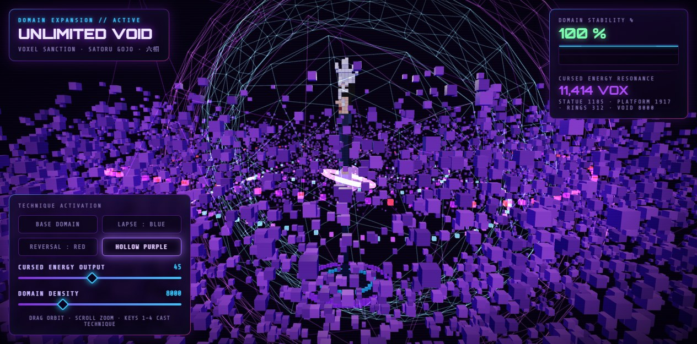
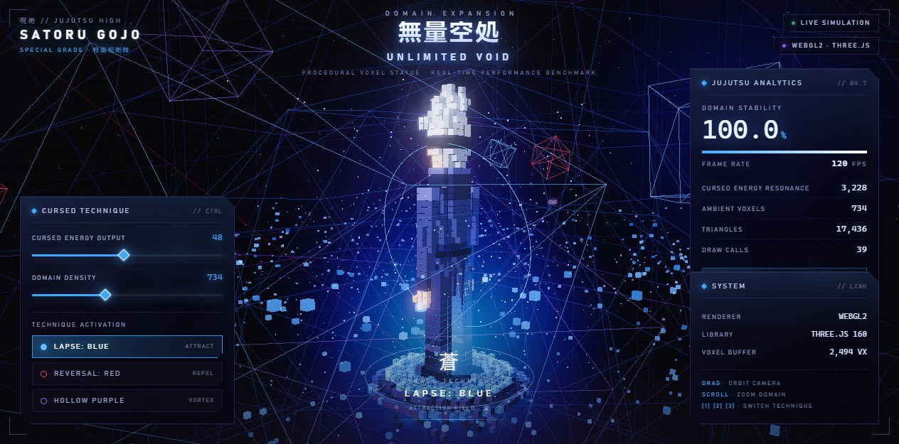
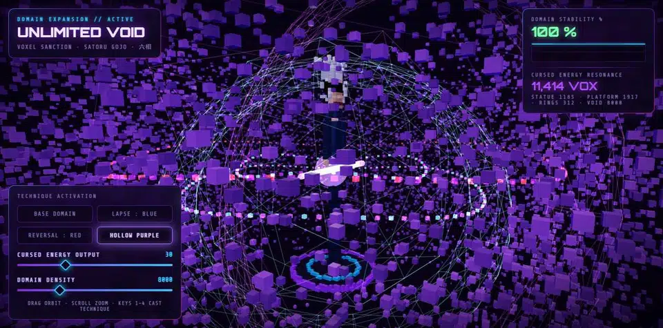
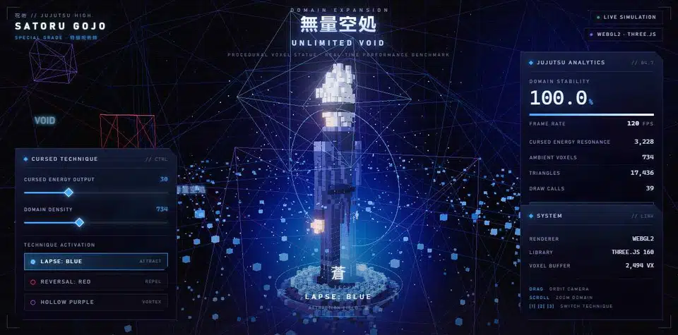

# Gojo Voxel: local Swift 1.5 IQ3_XXS vs the DeepSeek v4 Flash API

Measured November 8, 2026 (America/New_York), on [our host](../README.md#our-host):
i9-14900KF, RTX 4070 Ti SUPER 16 GB, 64 GB RAM, Windows 11.

This is the headline comparison of this repository: what a 16 GB consumer card
running **Qwen3.8-Flash-Next Swift 1.5 IQ3_XXS** on the Strata engine produces
against the **DeepSeek v4 Flash** cloud API, on the same creative-coding prompt.
Both sides ran in the same DSH agent harness with the same tool suite, the same
morning, starting within seconds of each other.

## The test

One prompt, byte-identical on both sides (2,832 bytes,
SHA-256 `9bfce99679e51f04208bf47556728a63170d67c2647a5c986ebb98a58bd6c903`):
write a **single, completely self-contained HTML file** (Three.js from a public
CDN) that renders a procedural **voxel statue of Satoru Gojo** — boots, high
collar, blindfold band, spiky white hair, pale face — at the center of a
spinning "Unlimited Void" domain of concentric particle rings and wireframe
geometry, with a cyber-occult UI: two sliders (rotation speed, ambient voxel
density), three technique modes (Lapse: Blue pulls voxels in, Reversal: Red
throws them out, Hollow Purple blends a purple vortex), and a corner analytics
panel tracking stability (FPS) and resonance (voxel count). No placeholders,
no truncated arrays, runs on open.

The full prompt is in [`docs/benchmarks/gojo-voxel/prompt.txt`](benchmarks/gojo-voxel/prompt.txt).

## Results

  
  

Left: AryaInfer Swift 1.5 IQ3_XXS, local. Right: DeepSeek v4 Flash API.
Same prompt, same morning, captured in the same browser at the same viewport.

  
  

Recordings of the two delivered files, captured in-browser at the same viewport:
local Swift (left, Hollow Purple) against the DeepSeek API (right, Lapse Blue).

| | **AryaInfer Swift 1.5 IQ3_XXS** | **DeepSeek v4 Flash (API)** |
| --- | --- | --- |
| Where it ran | This PC, fully local | Cloud API |
| Session window | 05:00:00 – 05:14:13 | 05:00:39 – 05:24:11 |
| Wall time | **853 s (14 min 13 s)** | **1,412 s (23 min 32 s)** |
| Agent steps / tool calls | 51 steps · 59 tool calls | 210 steps · 209 tool calls |
| Context window | 262,144 | 1,048,576 |
| Output file | 33,205 bytes | 64,183 bytes |
| Tokens (visible output) | 42,052 written · 85,283 new input · 4,093,721 cache reads | 164,606 written · 163,418 new input · 22,763,392 cache reads |
| Decode speed (all streamed tokens) | **~99 tokens/s** — harness badge read 90.1 tok/s mid-run, Monitor peaked at 122.4 t/s | **~233 tokens/s** |
| Cost | Electricity | API token billing at DeepSeek's published rates |
| Privacy | Nothing left the machine | Prompt and code sent to the provider |
| Self-verification | Ran the file in headless Chrome: 8 screenshots, 13 page-eval calls; **found and fixed one bug** (`ReferenceError: z`) | 19 browser opens, 34 screenshots, 29 page-eval calls; published previews of all three technique modes |
| Runtime state at capture | 100% stability, **11,414 voxels**, no console errors | 100.0% stability, 120 FPS, 2,494 VX voxel buffer, 17,436 triangles |

Both files open and run. The DeepSeek previews of all three technique modes are
in [`docs/media/benchmarks/`](media/benchmarks/).

## What each side did well

- **Swift 1.5 IQ3_XXS (local)** finished in 60% of the wall time with a
  quarter of the output tokens, built the denser world (11,414 voxels against
  the API file's 2,494-voxel buffer), and verified its own output in a
  browser — opened the page, scripted checks, found a real runtime error,
  fixed it, re-ran. It cost nothing beyond electricity and nothing left the
  PC.
- **DeepSeek v4 Flash (API)** produced the more polished layout: richer
  typography (kanji header, framed panels), a wider analytics readout (FPS,
  triangles, draw calls), a cleaner statue silhouette, and a larger file. It
  iterated far more (210 steps against 51) and wrote ~4x the tokens. Cloud
  models of this class are stronger per token and have 4x the context; that
  is the trade the API makes, and we state it plainly.

## Method and caveats

- One run per side, same harness, same morning. This is a showcase, not a
  controlled benchmark.
- Both session logs are aggregated in sanitized form:
  [`swift-session-stats.json`](benchmarks/gojo-voxel/swift-session-stats.json)
  and
  [`deepseek-session-stats.json`](benchmarks/gojo-voxel/deepseek-session-stats.json).
  The raw logs are not published (local file paths, account metadata).
- Token counts are from the harness usage records and count **visible output**
  (reply text + tool arguments). Reasoning tokens stream on top of that, so
  the engine-reported decode speed is roughly **2x** the visible-output rate:
  ~99 tok/s local (badge 90.1, Monitor peak 122.4) and ~233 tok/s on the API.
- We do not publish a dollar cost for the API run; multiply the token counts
  by DeepSeek's current published rates.
- Both HTML files need network access for the Three.js CDN and a WebGL 2
  browser.
- The Swift side ran the engine's IQ3_XXS quantization at 262,144 context;
  the API model exposes 1,048,576. The harness preset (`arya-standard`) was
  the same on both sides.

## Artifacts

| File | Side |
| --- | --- |
| [`prompt.txt`](benchmarks/gojo-voxel/prompt.txt) | shared (identical hash) |
| [`swift-1.5-iq3_xxs.html`](benchmarks/gojo-voxel/swift-1.5-iq3_xxs.html) | AryaInfer local run |
| [`deepseek-v4-flash.html`](benchmarks/gojo-voxel/deepseek-v4-flash.html) | DeepSeek v4 Flash API |
| [`swift-session-stats.json`](benchmarks/gojo-voxel/swift-session-stats.json) | sanitized session aggregate |
| [`deepseek-session-stats.json`](benchmarks/gojo-voxel/deepseek-session-stats.json) | sanitized session aggregate |

Open either HTML directly in a browser to run the benchmark yourself.
